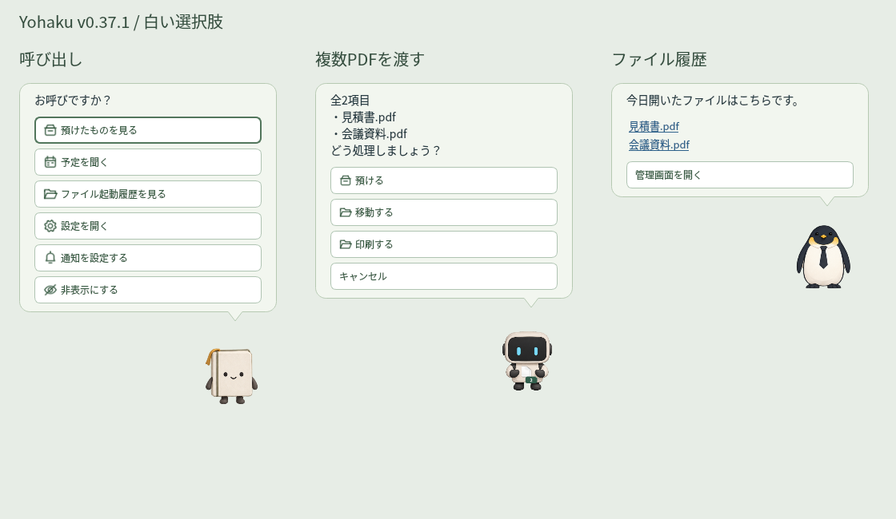

# ファイル・フォルダーをまとめて渡す（v0.37.0）

**v0.37.1：** 吹き出し内の選択肢は白地のボタンです。ホバー・押下・無効状態でも白地を保ち、枠線と文字色で状態を示します。履歴の吹き出しも淡い色にして、管理画面のボタンと区別します。

キャラにファイル・フォルダーを1〜500項目まとめて渡せます。いつもの吹き出しに件数と対象名を表示し、複数のときは手に持ったアイコンにも件数を付けます。単体の選択肢は継続します。Web URL・リンク・ショートカットの実体操作は対象外です。

| 渡すもの | 選択肢 |
|---|---|
| PDFだけ（単体・複数） | 預ける／移動する／印刷する／キャンセル |
| ZIP・7zだけ（両形式の混在も可） | 解凍する／移動する／キャンセル |
| その他のファイル、フォルダー、種類の混在 | 預ける／移動する／キャンセル |

PDFという名前のフォルダーはPDFとして扱いません。PDF＋ZIPなどの混在では印刷・解凍は出しません。単体の「ファイルを預ける」「フォルダを預ける」はこれまでの表記で、複数では「預ける」です。

選んだ移動先や用紙サイズは全件に適用し、順に処理します。印刷の「用紙サイズに合わせる」は各PDFの各ページを判定します。移動・解凍は同名の出力先や、選択した親フォルダーと子項目の重複を開始前に確認します。重複・衝突があれば処理を始めません。渡した後の変更も確認します。

処理中に失敗したらその項目で停止し、吹き出しに完了件数・完了名・未処理名（失敗項目を含む）を表示します。先に完了した移動や印刷は取り消しません。失敗した印刷では、一部のページが送信済みの場合がある旨も表示します。失敗した項目を含めた未処理分だけを確認して再度渡してください。

「預ける」は全件の参照を1回でJSON保存します。500件の登録上限を超える場合や保存に失敗した場合、途中まで追加しません。参照の登録なので内容の自動保存は許容し、本体を移動しません。



## ZIP・7zを解凍する

出力先の選択肢は登録済みの移動先一覧を共用します。元の圧縮ファイルは残し、出力先に各圧縮ファイル名のフォルダーを作って展開します。同じ名前のZIPと7zなど、同じ出力フォルダーになる組み合わせは上書きせず中止します。

通常ZIP・ZipCrypto・AES ZIPと、py7zrが対応する7z（暗号化ヘッダー付きも含む）に対応します。RARや分割アーカイブは解凍対象外です。7zの対応しない圧縮方式はエラーを表示し、元ファイルを保持します。

パスワードは `Data/file_drop_settings.json` の該当ルールの `password_template` を使います。`{month}` は01〜12、`{month1}` は1〜12、`{year}` は西暦です。複数でも各ファイル自身のルールを使い、パスワードをメッセージに表示しません。旧設定に7z専用ルールがない場合はZIPルールのテンプレートを共用します。個別設定したい場合はZIPルールから.7zを外して、.7z専用ルールを登録できます。

各圧縮ファイルの展開は10,000項目・合計1GiBまでです。不正なパス、リンク、同名項目、実サイズ超過を検査し、一時フォルダーへの展開と検証が済んでから公開します。7zもメモリ上に全ファイルを保持せず、制限付きのディスク書き込みを使います。


## 移動する

次の吹き出しに、登録済み移動先の**表示名**を縦に並べ、その下に「移動先を編集する」「キャンセル」を表示します。フルパスは選択肢にマウスを重ねると確認できます。移動先の表示名を押すと、その場所へ移動します。

未登録の場合も編集・キャンセルを表示します。「移動先を編集する」を押すと吹き出しを閉じ、専用の編集画面を開きます。**表示名とフォルダーのフルパス**を1組として、「＋ 移動先を追加」で追加できます。参照からフォルダーを選ぶこともできます。保存後に勝手に移動することはありません。編集後はもう一度ファイルを渡して処理を選びます。


保存先は `Data\file_destinations.json`。PDF・通常ファイル・フォルダーで共通の一覧です。最大100件で、表示名は重複しない1〜60文字です。保存時に `.json.bak` を残し、不正なJSONは元のファイルを保持してエラーを表示します。旧版の拡張子別移動先は初回に重複を除いて読み込み、明示して保存するまで元のJSONを書き換えません。

```json
{
  "schema_version": 1,
  "destinations": [
    {"id": "submit", "name": "提出用", "path": "C:\\Yohaku\\提出用"},
    {"id": "archive", "name": "保管用", "path": "D:\\保管"}
  ]
}
```

選択肢を表示した後でJSONを変更しても、その時の選択肢が指すパスはすり替わりません。次回の移動先選択で読み直します。同名項目は上書きしません。フォルダーは一時コピーを検証後に配置し、コピー後に編集・追加された元の項目は削除せず残してお知らせします。リンク・自己配下への移動を拒否し、フォルダーは10,000項目・合計1GiBまでです。

## 印刷する

次の吹き出しは「A4で印刷する」「A3で印刷する」「用紙サイズに合わせる」「キャンセル」です。A4・A3・自動のどれかを押すと、**Windowsの既定プリンターへ、全ページを1部、印刷ダイアログを出さずに送信**します。PDFそのものを変更しません。

- A4／A3指定：全ページを指定した用紙へ、縦横比を保って収めます。
- 用紙サイズに合わせる：各ページを判定し、A4以内ならA4、それより大きいページ（B4、A3、A2など）はA3へ収めます。約1pt以内のPDF生成時の丸め差はA4として扱います。
- ページの縦横に応じて用紙の縦向き・横向きを設定します。印刷可能な領域の中央に配置します。
- 文書の描画結果を見て、色のあるページが1つでもあればカラー、全ページがグレーならモノクロを自動設定します。プリンターの能力・ドライバーによる最終的な出力・課金区分はプリンター側に従います。

PDFは256MiB以内・1,000ページ以内で、暗号化PDFは対象外です。全ページの読み込み・用紙対応を確認してから送信を始めます。既定プリンターがない、または必要な用紙に対応していない場合はエラーを表示します。処理はバックグラウンドで同時に1件。連打しても二重に送信しません。送信中の終了操作は完了待ちになります。送信開始後のエラーでは、一部ページが送信済みの可能性を表示します。

キャンセルは印刷開始前の選択画面で行います。送信後の取り消しはWindowsの印刷キューで行ってください。テストはWindows上の仮想PDF出力で行い、実プリンターの給紙・カラー出力は未検証です。

## ポーズと通知

3体・9ポーズ、ペギーの名前、手紙の薄い水色、予定表の穏やかな表情は維持します。ファイル処理の選択中に新着メールが届いても、選択を維持して一時的に手紙を掲げます。本文の強調・ユーザー通知の文字装飾も継続します。[文字の強調](MESSAGE_FORMAT.md)

## v0.26.1の印刷互換修正

余白を含むレイアウト一式を設定せず、Windowsドライバーに用紙サイズと向きを個別に指定します。ドライバーが返す用紙・向きを確認し、用紙の丸め差は2ptまで許容します。設定が反映されていない場合は印刷を止めます。ドライバーが報告する対応用紙の定義を優先して使います。

印刷開始後にA4とA3・縦横が切り替わる場合も、QtのWindows印刷エンジンへ次ページの用紙設定を渡し、ページ境界で反映します。実行中のネイティブ印刷で用紙変更を拒否するQtの公開setterは使用しません。

## v0.27.0の「預ける」

ドラッグ時の先頭の「預ける」は、本体を移動せず参照だけを保存します。呼び出しの先頭の「預けたものを見る」からダブルクリックで開けます。[保持期間・削除の扱い](SHELF.md)
