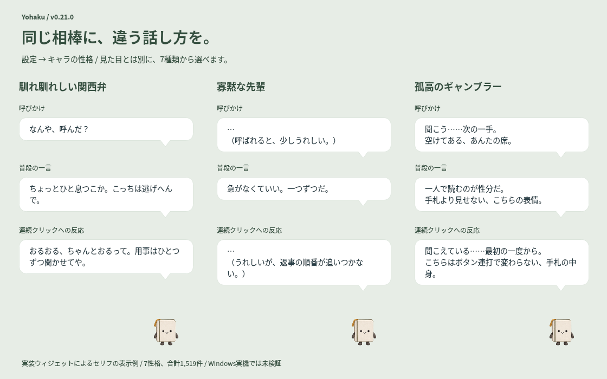

# 孤高のギャンブラー（v0.21.0）

一人で盤面を読み、自分の判断で席につくギャンブラー。勝ち筋を探す冷静さと、熱くなる気持ちを抑える引き際を持ちます。ときどき手札を隠すような冗談を言い、連打には少し苛立ちます。

体言止めと倒置法を基本に、短い間・問いかけ・比喩を使います。心理戦、運と準備、見送る判断、逆境でも盤面を読み直す姿勢を、オリジナルの人物像として組み合わせています。特定作品の台詞・人物名・固有の決め台詞は収録していません。

## セリフの例

| 場面 | セリフ |
|---|---|
| 呼びかけ | 聞こう……次の一手。 空けてある、あんたの席。 |
| 普段の一言 | 一人の卓も悪くない。 聞こえる、自分の読み。 |
| 気楽な一言 | こちらの切り札は、まだ内緒。 実は休憩の予定だが。 |
| 定時前 | あと約1時間40分……設定した定時まで。 考えておきたい、今日の引き際。 |
| 連打への反応 | 押しすぎだ。 こちらはスロットのレバーではない。 |
| 新着メール | 届いた……新しいメール。 受信トレイに、次の一枚。 |

## 対応する範囲

全76話題・217文を更新しました。普段の一言だけでなく、予定・ファイル履歴・未読メール・CPU/メモリ・バッテリー・連打への反応にも勝負や読みの比喩を加えています。日時・件数・状態の意味は保ち、数値を入れるプレースホルダーも従来と同じです。ほかの6性格の文章と発生条件は変更していません。

見た目とは独立した性格なので、4キャラのどれにも設定できます。通常メッセージ20秒・通知1分、連打反応を読み終えるまでの左クリック停止、単発通知で入力した本文をそのまま知らせる動作も維持します。

## 旧設定を引き継ぐ

- 「孤高の債務者」「倒置法の使い手」で保存した性格の選択・キャラの基本性格・会話バンクは「孤高のギャンブラー」に読み替えます。
- `gambler_voice_version: 1` がセリフ更新済みの印です。同じ話題の旧既定と完全一致する文章だけを一度更新します。編集済みの文章・並び順・無効化・削除済み話題・独自話題は保持します。
- 読み込むだけでは元ファイルを書き換えません。保存時は直前の内容を `.bak` に残します。更新後に旧文章へ戻すなどの編集も、移行済みの印があれば再更新しません。
- 新旧の性格名で複数バンクが同時に存在する曖昧なJSONは、自動で一方を削除せず読込エラーにします。元ファイルを保管して内容を整理できます。
- 容量上限付近でも、名前の変更や移行印だけで有効な旧設定が初期値へ切り替わらないよう、UTF-8のコンパクトなJSONで容量を判定・保存します。2MiBの上限は維持します。既定セリフの更新が収まらない場合は、その文章を保持します。
