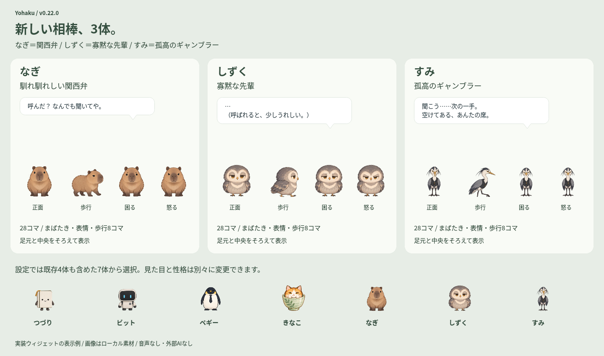

# 新しい3体 — v0.22.0

| 名前 | 姿 | キャラクターに合わせる場合の性格 |
|---|---|---|
| なぎ | 丸い鼻のカピバラ | 馴れ馴れしい関西弁 |
| しずく | 灰色とクリーム色のふくろう | 寡黙な先輩 |
| すみ | 細身のベスト姿のサギ | 孤高のギャンブラー |

ユーザー指定の組み合わせです。提案時の性格の割り当てから、なぎとすみを変更しました。

「キャラと通知」のサムネイルから選択します。既存のつづり・ビット・ペギー・きなこはそのまま使え、計7体を2段に並べています。名前の前に識別用アルファベットは表示しません。

「キャラの性格」が「キャラクターに合わせる」の場合に上記の話し方を使います。性格を個別指定している場合は指定を維持します。7体と7性格を自由に組み合わせられます。

## 表情と動き

各キャラに通常の表情・しぐさ16コマ、歩行8コマ、正面・正面まばたき・困る・怒るの4コマ、計28コマを用意しています。なぎは表情豊かな相棒、しずくは控えめな目の変化、すみは鋭い目つきと落ち着いた立ち姿を基本にしています。

新しい透過PNGは素材を共通の大きさのキャンバスへ描画し、中央と足元をそろえます。各コマを別々に拡大縮小せず、既存のフレーム補間と移動処理を使います。吹き出しの操作・連打への反応・ドラッグ・表示時間の仕様は共通です。

画像は開発時に生成した静的なローカル素材です。アプリ実行時の画像生成や外部AIへの接続はありません。

## 設定の引き継ぎ

旧会話JSONを読み込むと、新しい3体の説明・代表的な一言・初期の性格だけを補います。既存4体のプロフィール、全7性格のセリフ、会話の条件、個別の性格指定を変更しません。読み込みでは原本を書き換えず、会話編集画面から保存した際は従来どおりバックアップします。

旧JSONが2MiBの上限付近で追加できない場合は、原本のデータを優先して新3体の初期プロフィールを実行時に参照します。既存データを初期化しません。新しいプロフィールを編集して保存するときも2MiB制限を確認します。

単体の素材PNGと配置JSONはonedirビルド・2つのソースZIPの対象です。
