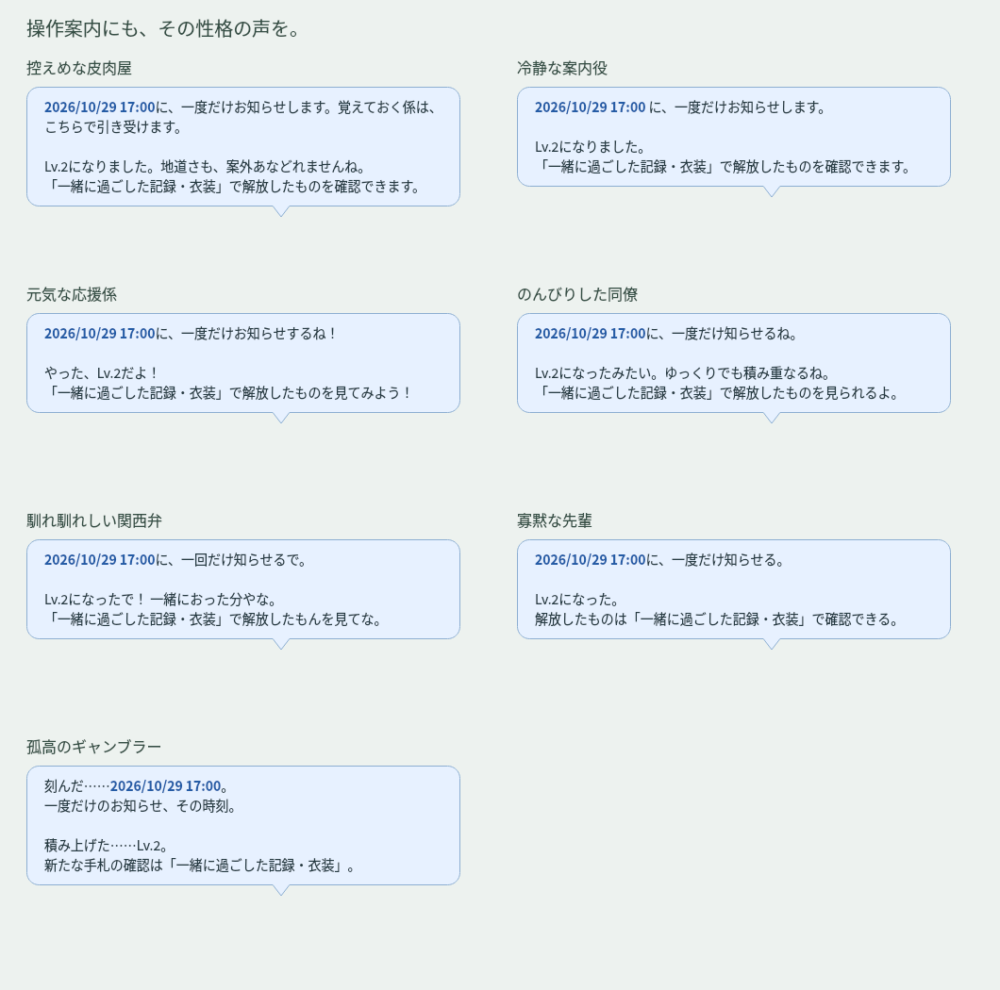
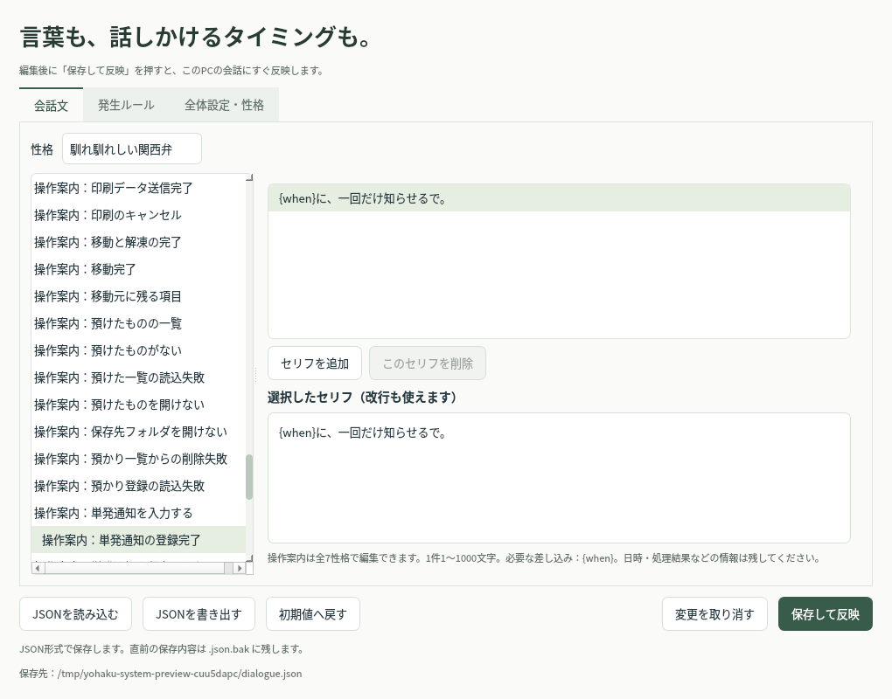

# 操作案内の性格対応 v0.33.0

呼び出し後の吹き出しで、共通の定型文に戻っていた案内を見直しました。43項目・301文を全7性格に分け、現在選択中の性格を使います。「キャラクターに合わせる」の場合はキャラ設定の性格に従います。既存の呼びかけ・予定の導入・メール通知は、従来の編集済みセリフを継続します。

対象は、ファイルを渡したときの3段階の質問、移動先の未登録、預かり・移動・印刷の結果、処理中・処理失敗、預けた一覧、単発通知の入力と登録・入力エラー、履歴の補足と読込・起動失敗、予定の部分取得・Outlook起動失敗、勤怠サイトの案内、退勤前の既定メッセージ、レベルアップと実績の記録です。詳細なエラー理由、日時、フルパス、PC起動時刻・経過時間は保持します。

寡黙な先輩は短い言葉、関西弁は親しみのある口調、孤高のギャンブラーはオリジナルの倒置・体言止めと手札などの比喩を使います。先輩の心の声は「…」だけの発言に限る従来ルールを維持し、情報を伝える操作案内には足しません。

## 編集

設定の会話編集を開き、「会話文」で性格を選び、話題一覧の下にある **操作案内：…** を選択します。セリフの追加・削除・改行に対応し、「保存して反映」で適用します。複数登録した場合は、その項目を表示するときに候補から選びます。これらは操作に対する返答であり、自動会話の新しい発生ルールにはなりません。

ユーザーの編集内容は **EXEの隣のData/dialogue.jsonのsystem_phrases** に保存します。旧JSONを読む際は、既存の会話・ルール・性格設定を変えず、この欄がなければ初期値を補います。読込だけでは元のJSONを書き換えず、編集画面の保存時にJSONと直前のバックアップへ保存します。登録済みのsystem_phrasesを新版の初期値で上書きしません。

初期値の原本はcompanion/assets/dialogue/system_phrases.jsonです。通常はData側か編集UIを使ってください。1項目1〜200候補、1候補1〜1000文字、会話JSON全体2MB以内です。新たな自動発言ルールを追加しないため、既存のルール上限200件を消費しません。サイズ上限に近い旧JSONには無理に初期値を足さず、表示時に同梱初期値を使います。編集して容量を超える場合は保存前にエラーを出し、元のJSONを保持します。

| 差し込み | 内容 |
|---|---|
| `{when}` | 単発通知を登録した日時 |
| `{time}` | その日に設定可能な最も早い時刻 |
| `{path}` | 移動・解凍後のフルパス |
| `{detail}` | 登録できない具体的な理由 |
| `{level}` | 到達したレベル |
| `{name}` | 記録した実績名 |

項目ごとの必要な差し込みは編集欄の下に表示します。必要な差し込みの欠落や、その項目にない変数は保存前に検査します。差し込みは一度だけ行い、ファイル名などに含まれる波括弧は再解釈しません。

ユーザー登録通知の本文・装飾、ユーザーが編集した退勤前メッセージ、既存の会話、追加パックのセリフはそのまま使います。退勤前メッセージが従来の初期文の場合だけ、選んだ性格の既定文に置き換えます。選択肢の名称や設定画面の項目名、システムの詳細な診断は、意味を確認できる表記を保ちます。

## 確認方法

Windows CIで全性格の差し込み・JSON移行・容量上限時の読込・不正な編集の保存拒否・編集UI・実際の呼び出しからの案内・退勤前のユーザー文保持を確認します。配布ZIPからもEXE化し、同梱JSONと性格別案内の描画チェックを実行します。Linuxではアプリの単体テストやself-checkを実行せず、静的構文・アーカイブ確認と、実データを使わないUIプレビュー生成だけを行います。
