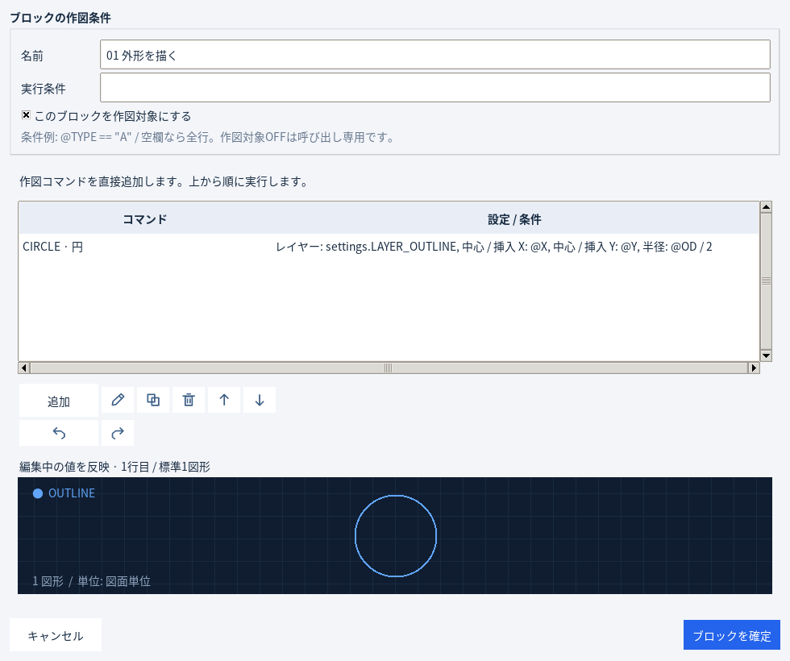

# AcadStadio 1.19.4

**[ZIPをダウンロード](https://github.com/alz7485/codex3/raw/refs/heads/main/downloads/AcadStadio/AcadStadio_v1.19.4.zip)** / [SHA256](AcadStadio_v1.19.4.zip.sha256)

公開日: 2026-10-25（JST）。Pythonソース版です。EXEは含みません。

ローカル変数の編集画面・参照候補・新規SET代入コマンドを廃止しました。ブロックへ線・円・文字などを直接追加し、入力表や共通設定から値を指定します。

- 固定値: `50`
- 入力表の列: `@OD`
- 計算式: `@OD / 2`
- 共通設定: `settings.TEXT_HEIGHT`

標準サンプルと配布例も直接の式に統一しています。フォルダ管理・検索・複数入力表・設定プリセット・CAD初期設定・システム設定復元は引き続き利用できます。




## 起動

Python 3.11以降で、ZIPを展開したフォルダから実行します。

```powershell
py -3 -m pip install -r requirements.txt
py -3 src/main.py
```

`AcadStadio.pyw`からも起動できます。

## EXE化（onedir）

```powershell
py -3 -m venv .venv
.\.venv\Scripts\python.exe -m pip install -r requirements.txt pyinstaller
.\.venv\Scripts\python.exe -m PyInstaller --clean --noconfirm AcadStadio.spec
```

出力は `dist/AcadStadio/AcadStadio.exe`。フォルダ全体を配布してください。同梱 `EXE_BUILD_ONEDIR.md` に詳細があります。

基本処理175件・実Tk GUI157件、計332件合格。ZIPのCRC・全ファイルSHA256・展開後スモークも確認。Windows EXEとAutoCAD実機は未検証です。
