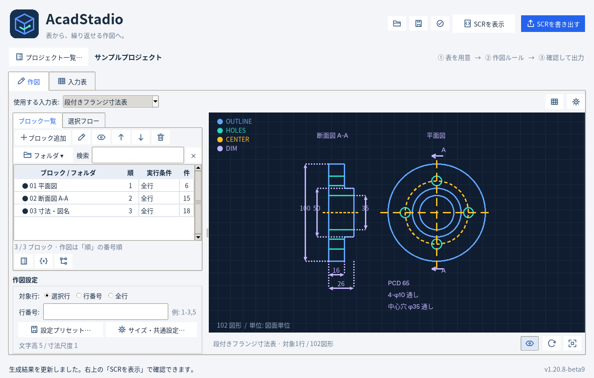
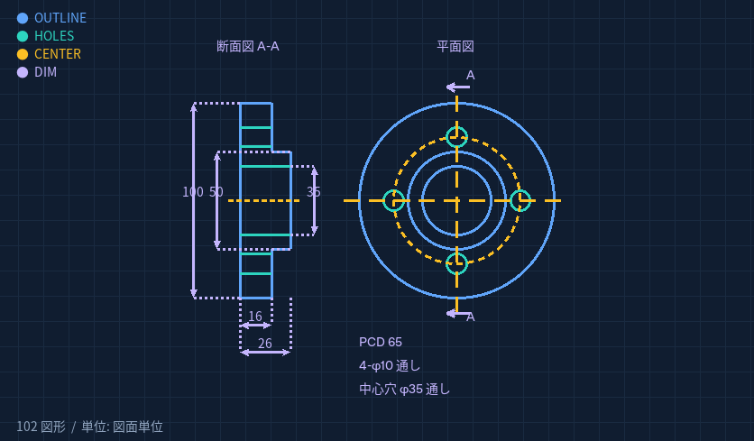
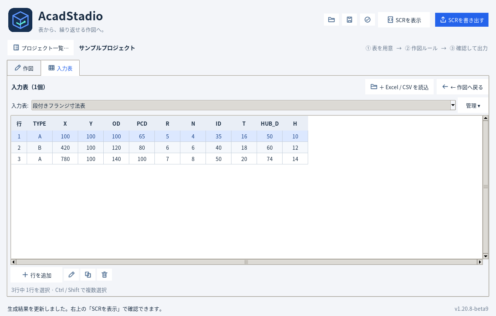
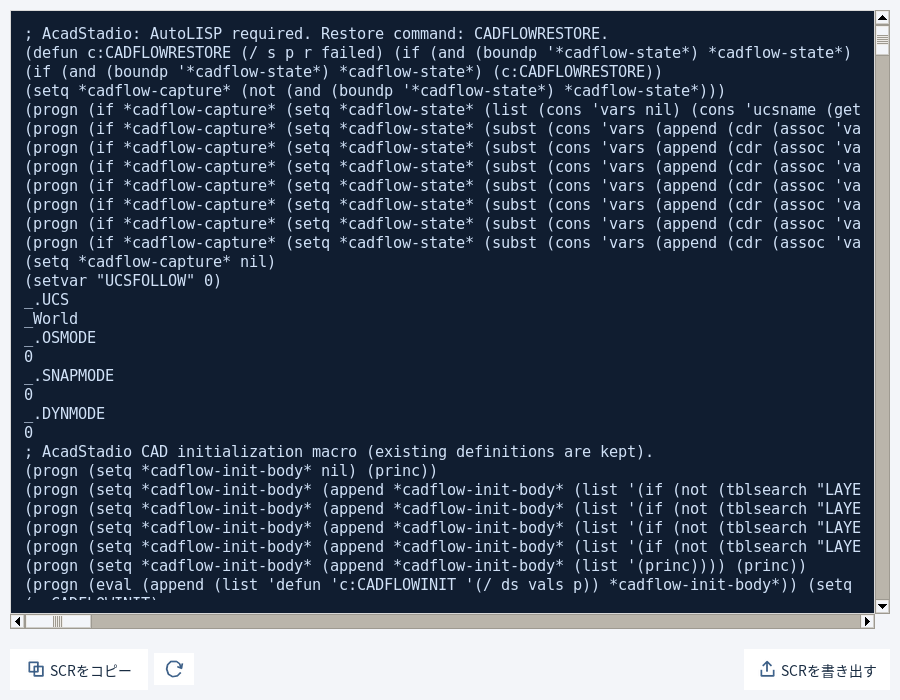

# AcadStadio 1.20.8 — 全輪郭線表示・試用版9

**[試用版9 ZIPをダウンロード](https://github.com/alz7485/codex3/raw/refs/heads/main/downloads/AcadStadio/AcadStadio_v1.20.8_CompleteOutlineTrial9.zip)** ／ [SHA256](AcadStadio_v1.20.8_CompleteOutlineTrial9.zip.sha256)

画像の構成に合わせて、左に断面図（A-A）・右に平面図を並べた段付きフランジを標準サンプルにしました。中心穴と取付穴は、いずれもねじのない通し穴です。

- 平面図に外周・段の外周・中心穴・等配の取付穴・PCD・中心線を表示。
- 断面図に板厚と段差を表示。上下の取付穴と中心穴を通る切断面です。
- 断面の端面・外周線は穴の位置でも途切れさせず、全体を連続して表示。
- ボルト穴の上下2辺を板厚全体、中央穴の上下2辺を段を含む全厚にわたって表示。
- ハッチングを削除。ブロックは平面図・断面図・寸法図名の3つに整理。
- 外径・段の外径・中心穴径・板厚・全厚（板厚＋段の高さ）の寸法を表示。
- 入力表の寸法変更に両図が連動。JSON・CSV・Excel・生成SCRも更新。
- 初期表示は1行目。寸法違いの3行を同梱し、追加のLINファイルなしで作図できます。

Trial6で整理した操作画面も継続しています。

- メイン画面をプレビュー専用に変更。プレビュー／SCRのタブは廃止。
- 入力表選択の右側と、その下の作図条件表示を削除してプレビューを上へ拡張。
- 生成SCRは右上「SCRを表示」から別ウィンドウで表示。コピー・再生成・書き出しができます。
- 各表に縦横の罫線を表示。スクロールや列幅変更にも追従します。
- DWG設定読込の絞り込み欄を削除し、チェック表へ統一。
- DWGを読込画面へドラッグ＆ドロップ可能（Windows）。1ファイルを受け付け、そのまま読み取りを開始。
- LINファイル指定欄を廃止。線種はCAD側に存在する同名の線種を使用。



## 起動

Python 3.11以降（tkinterを含む）が必要です。ZIPをすべて展開し、フォルダで実行します。

```powershell
py -3 -m pip install -r requirements.txt
py -3 src/main.py
```

`AcadStadio.pyw` からも起動できます。DWGの読取はWindows版AutoCADを起動して利用します。

## サンプルの寸法

|列|意味|
|---|---|
|TYPE|部品の識別名|
|X / Y|平面図の中心位置|
|OD|外径|
|ID|中心穴径|
|PCD|ボルト穴の中心円直径|
|R|ボルト穴の半径（穴径は2×R）|
|N|ボルト穴数（同梱例は4・6・8）|
|T|本体の板厚|
|HUB_D|段の外径|
|H|段の高さ（全厚はT＋H）|

「入力表」で編集し、「作図設定」の対象行で切り替えます。初期選択は1行目だけです。「全行」なら3部品をまとめて作図します。
図の間隔は共通設定 `VIEW_GAP` で調整できます。
サンプルは中心穴と上下の取付穴を通る、偶数穴の段付きフランジです。寸法は `0 < ID < HUB_D < PCD - 2×R`、`PCD + 2×R < OD`、`R > 0`、`T > 0`、`H > 0` を満たす値にします。Nは正の偶数です。形状が成立しない値の自動補正はありません。
輪郭と破線は通常の線分として生成し、CADの線種定義を追加しません。
CAD初期設定はサンプルでONです。既存図面の同名レイヤーを使う場合はOFFにできます。

## 作図

1. 「入力表」でExcel / CSVを読み込み、使用する入力表を選びます。
2. 「ブロック追加」でコマンドを直接追加します。入力値は `@OD / 2`、共通設定は `settings.TEXT_HEIGHT`、変数は `変数.参照行` で参照できます。
3. 「表・変数」から表の列・セルを選んで参照式を入力できます。複数表・固定行・変数での行指定に対応。
4. 左下「作図設定」で対象行・サイズ・設定プリセットを選びます。フォルダ利用時や小さい画面ではボタンから開きます。
5. プレビューを確認し、右上「SCRを表示」または「SCRを書き出す」を使います。
6. プロジェクトはCtrl+SでJSON保存します。

## DWGから設定を取得

「CAD初期設定…」→「DWGから読み込み…」を開きます。DWGを画面へドロップするか、「参照…」で選択して読み取ります。
AutoCADを起動しておいてください。読取後に登録する項目へチェックし、「チェックした項目を登録」→「設定を確定」で反映します。

線種は名前の登録だけです。形状定義は複製せず、使用するCAD図面に同名の線種があることが必要です。追加のLINファイルは指定しません。
詳細は CAD初期設定（ZIP内 docs/CAD_INITIALIZATION.md） と 複数表・行指定（ZIP内 docs/TABLE_ROW_REFERENCES.md） を参照してください。

## onedirでEXE化

```powershell
py -3 -m venv .venv
.\.venv\Scripts\python.exe -m pip install -r requirements.txt pyinstaller
.\.venv\Scripts\python.exe -m PyInstaller --clean --noconfirm AcadStadio.spec
```

出力は `dist/AcadStadio/AcadStadio.exe`。フォルダ全体を配布してください。同梱の EXE_BUILD_ONEDIR.md（ZIP内 EXE_BUILD_ONEDIR.md） に詳細があります。
このZIPはソース版で、EXEは含みません。

検証結果は VALIDATION（ZIP内 docs/VALIDATION.md） に記録しています。Windows上のExplorerからの実ドロップ・AutoCAD実DWG読取・Windows EXEは未検証です。

380件のテストに合格。Windows / AutoCADでの実行は未検証です。






