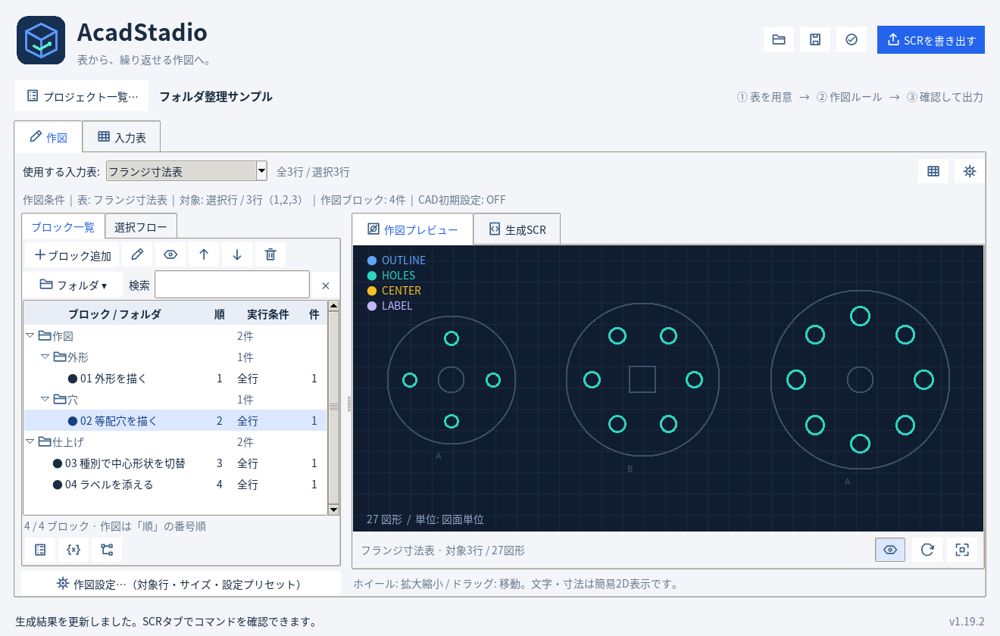

# AcadStadio 1.19.2

Excel / CSVの入力表と作図ブロックから、AutoCAD用SCRを作成するWindows向けアプリです。アプリ名をCADFlow Studioから **AcadStadio** に変更しました。

**[ZIPをダウンロード](https://github.com/alz7485/codex3/raw/refs/heads/main/downloads/AcadStadio/AcadStadio_v1.19.2.zip)** / [SHA256](AcadStadio_v1.19.2.zip.sha256)

公開日: 2026-10-25（JST）。Pythonソース版です。EXE自体は含みません。



## 起動

ZIPを展開し、`AcadStadio_v1.19.2` フォルダで実行します。Python 3.11以降が必要です。

```powershell
py -3 -m pip install -r requirements.txt
py -3 src/main.py
```

`AcadStadio.pyw` のダブルクリックでも起動できます。

## EXE化（onedir）

```powershell
py -3 -m venv .venv
.\.venv\Scripts\python.exe -m pip install -r requirements.txt pyinstaller
.\.venv\Scripts\python.exe -m PyInstaller --clean --noconfirm AcadStadio.spec
```

出力は `dist\AcadStadio\AcadStadio.exe`。フォルダ全体を配布してください。詳細は同梱の `EXE_BUILD_ONEDIR.md` を参照してください。

## 互換性と機能

旧JSON・登録コマンドJSONを利用できます。既存のCADFlowStudio保存フォルダがあれば継続利用し、新規利用時はAcadStadioへ保存します。ACADSTADIO_DATA_DIRを優先し、旧CADFLOW_DATA_DIRも利用できます。

フォルダ管理・検索・ブロック一覧内の操作ボタン、複数入力表、設定プリセット、CAD初期設定、ユーザーコマンド登録、作図後のシステム設定復元を保持しています。CADFLOWRESTORE等の既存CADコマンド名は互換性のため維持しています。

基本処理175件・実Tk GUI156件、計331件が合格。旧保存先・復元データ・環境変数の互換性、展開後のスモーク、ZIPのCRCと全ファイルSHA256を確認しています。Windows EXEのビルド・実行とAutoCAD実機は未検証です。

[旧版と以前の操作ガイド](../CADFlowStudio/)
