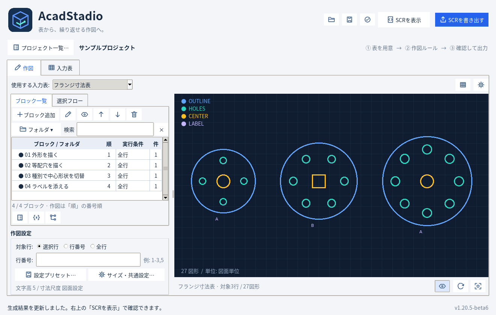
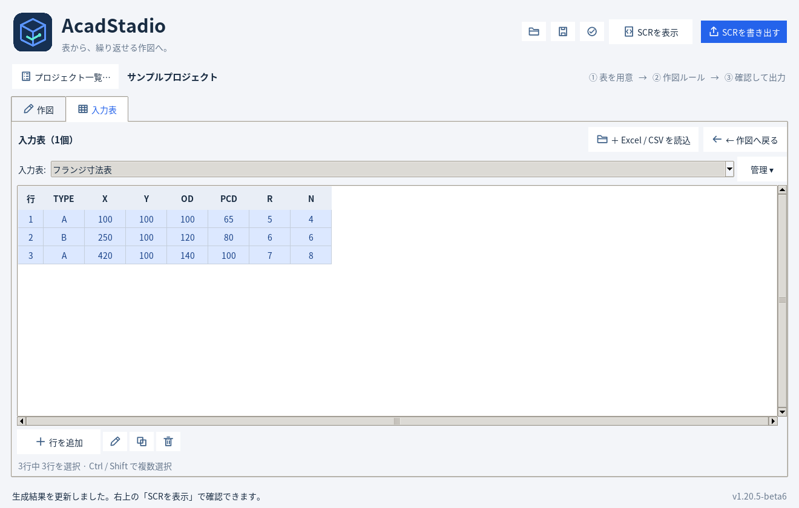
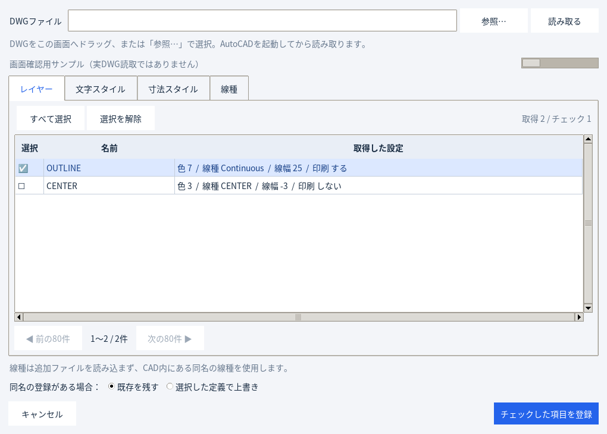
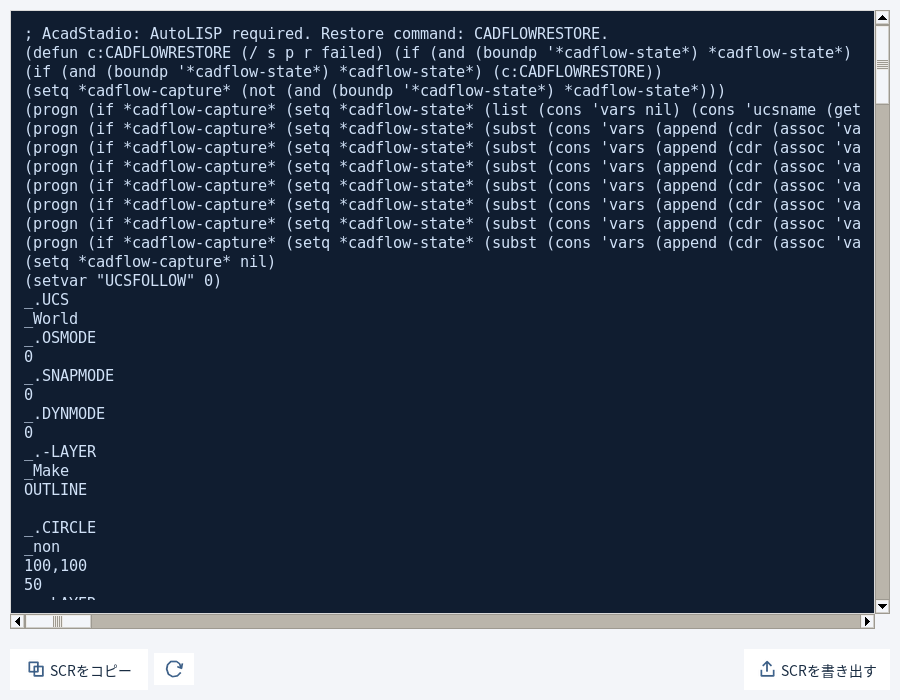

# AcadStadio 1.20.5 — UI整理試用版6

**[試用版6 ZIPをダウンロード](https://github.com/alz7485/codex3/raw/refs/heads/main/downloads/AcadStadio/AcadStadio_v1.20.5_SimpleUITrial6.zip)** / [SHA256](AcadStadio_v1.20.5_SimpleUITrial6.zip.sha256)

Trial5を基に、操作画面を整理しました。

- メイン画面をプレビュー専用に変更。プレビュー／SCRのタブは廃止。
- 入力表選択の右側と、その下の作図条件表示を削除してプレビューを上へ拡張。
- 生成SCRは右上「SCRを表示」から別ウィンドウで表示。コピー・再生成・書き出しができます。
- 各表に縦横の罫線を表示。スクロールや列幅変更にも追従します。
- DWG設定読込の絞り込み欄を削除し、チェック表へ統一。
- DWGを読込画面へドラッグ＆ドロップ可能（Windows）。1ファイルを受け付け、そのまま読み取りを開始。
- LINファイル指定欄を廃止。線種はCAD側に存在する同名の線種を使用。



## 起動

Python 3.11以降（tkinterを含む）が必要です。ZIPをすべて展開し、フォルダで実行します。

```powershell
py -3 -m pip install -r requirements.txt
py -3 src/main.py
```

`AcadStadio.pyw` からも起動できます。DWGの読取はWindows版AutoCADを起動して利用します。

## 作図

1. 「入力表」でExcel / CSVを読み込み、使用する入力表を選びます。
2. 「ブロック追加」でコマンドを直接追加します。入力値は `@OD / 2`、共通設定は `settings.TEXT_HEIGHT`、変数は `変数.参照行` で参照できます。
3. 「表・変数」から表の列・セルを選んで参照式を入力できます。複数表・固定行・変数での行指定に対応。
4. 左下「作図設定」で対象行・サイズ・設定プリセットを選びます。フォルダ利用時や小さい画面ではボタンから開きます。
5. プレビューを確認し、右上「SCRを表示」または「SCRを書き出す」を使います。
6. プロジェクトはCtrl+SでJSON保存します。

## DWGから設定を取得

「CAD初期設定…」→「DWGから読み込み…」を開きます。DWGを画面へドロップするか、「参照…」で選択して読み取ります。
AutoCADを起動しておいてください。読取後に登録する項目へチェックし、「チェックした項目を登録」→「設定を確定」で反映します。

線種は名前の登録だけです。形状定義は複製せず、使用するCAD図面に同名の線種があることが必要です。追加のLINファイルは指定しません。
詳細はZIP内の docs/CAD_INITIALIZATION.md と docs/TABLE_ROW_REFERENCES.md を参照してください。

## onedirでEXE化

```powershell
py -3 -m venv .venv
.\.venv\Scripts\python.exe -m pip install -r requirements.txt pyinstaller
.\.venv\Scripts\python.exe -m PyInstaller --clean --noconfirm AcadStadio.spec
```

出力は `dist/AcadStadio/AcadStadio.exe`。フォルダ全体を配布してください。同梱の EXE_BUILD_ONEDIR.md に詳細があります。
このZIPはソース版で、EXEは含みません。

基本処理210件・GUI166件、計376件PASS。検証結果はZIP内 docs/VALIDATION.md に記録しています。Windows上のExplorerからの実ドロップ・AutoCAD実DWG読取・Windows EXEは未検証です。


## 各画面





DWG画面は表示用サンプルで、実DWG読取結果ではありません。


