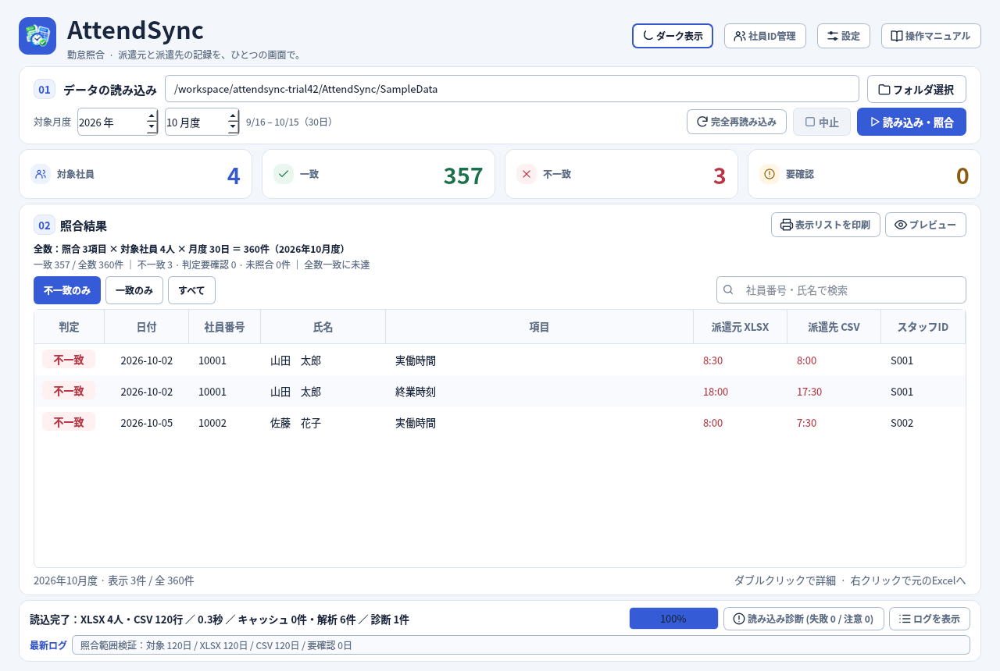

# AttendSync Trial42

[最新版ZIPをダウンロード（約9.5MB）](https://github.com/alz7485/codex3/raw/refs/heads/main/downloads/AttendSync/AttendSync_Trial42_Final_Audit_Complete.zip)

月度日数と全数確認に対応しました。

- 期間の右側に日数を表示：9/16～10/15（30日）。
- 照合結果の上に計算式を表示：照合3項目 × 対象社員4人 × 月度30日 ＝ 全数360件。
- 全数 ＝ 一致 ＋ 不一致 ＋ 判定要確認 ＋ 未照合。診断用の要確認は別計上します。
- 欠落・未紐付け・重複・読み込み失敗がある場合は全数一致と表示しません。
- 項目追加・ON/OFFに対応。検索・表示フィルターでは全数は変わりません。

全数は読み込み済みXLSX社員の予定件数です。読み込みに失敗したファイルの社員数は特定できません。

画像付き操作マニュアル・設定・監査報告を同梱したソース版です。ZIP展開後、CODEX_START_HERE.txt と AttendSync/README.md を参照してください。Python環境と依存ライブラリが必要です。ビルド済みEXEは含みません。

全32テストスクリプト成功、今回追加した回帰検証16件成功。Windows実機・Excel COM実機・実プリンター・Trial42マニュアルの実ブラウザー確認は未実施です。

SHA256: `173b2cde6393e373585d7221059ff30b2c18d738ce3d4bafe33f6172bb2d6b3b`
