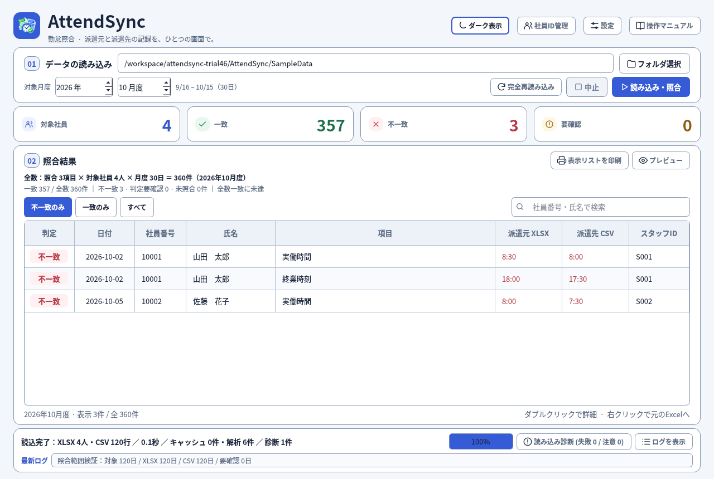
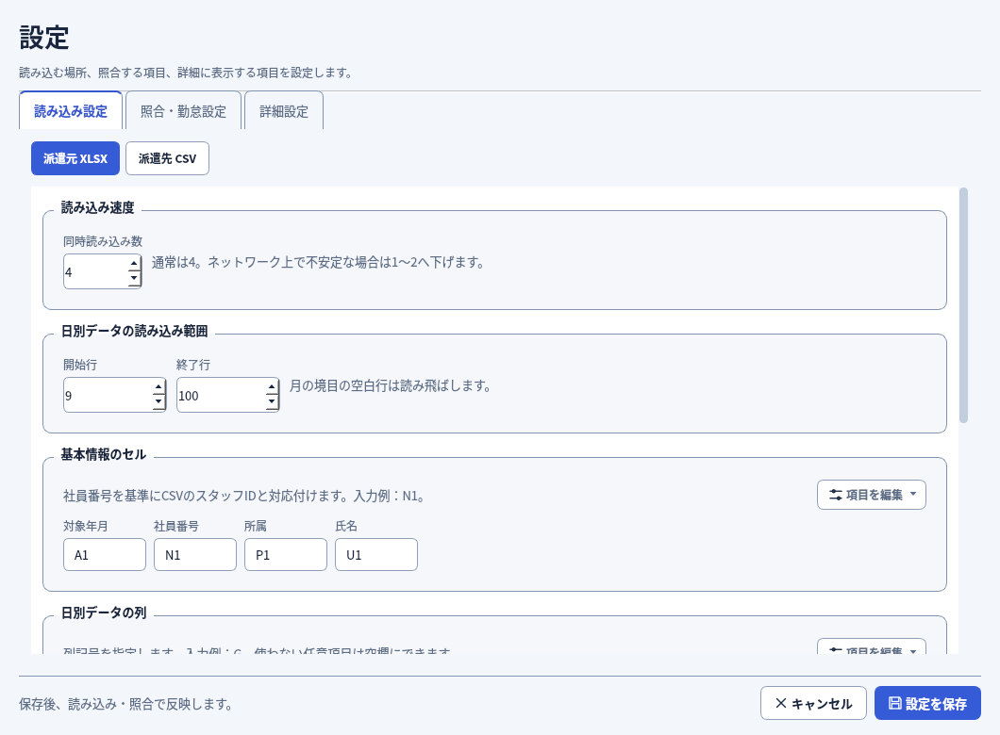

# AttendSync Trial46 — 最終専門レビュー版

[最新版ZIPをダウンロード（約10.4MB）](https://github.com/alz7485/codex3/raw/refs/heads/main/downloads/AttendSync/AttendSync_Trial46_Final_Reviewed_Complete.zip)

4人のレビュー専門エージェントが、照合処理・設定と社員ID・UIとマニュアル・配布構成を独立監査しました。指摘を修正して再確認し、全39テストスクリプトと最終追試5本が合格しています。新規の回帰テストは4本・31メソッドです。4人の監査報告と画像付き操作マニュアルをZIPに同梱しています。

[最終監査報告](AUDIT_TRIAL46.md) / [完成ZIPの独立検査](PACKAGE_CHECK_TRIAL46.md)

今回の修正：

- XLSXの不正な日・月・日付を要確認にし、誤って全数一致と表示する問題を修正。
- 計算結果を保存していない数式を検出。日別項目と対象年月のセルを確認し、計算済みの数値・0・空文字と区別。
- 保存先が両方とも使用できない場合、起動時に原因と保存先を表示。
- Enterキーで詳細を開けるようにし、ダブルクリックとの重複起動を防止。
- 設定・社員ID管理・詳細・診断などを閉じた後の画面オブジェクト残留を解消。

採用済みの枠線UI、読み込み速度・範囲を先頭に置く設定配置、XLSX設定末尾の月度処理、JSONによる項目拡張を維持しています。初期月度はPCの日付の月です（10月16日でも10月度）。社員ID管理は未紐づけがあれば未紐づけ、なければすべてを表示します。全数は「有効な照合項目数 × 読み込めた人数 × 対象期間の日数」で確認できます。

数式の計算結果が未保存の場合は、Excelで再計算して保存してください。更新後は旧キャッシュを再解析します。設定と社員IDの紐づけは維持します。

このZIPはソース・マニュアル・監査報告の配布物です。Windows用EXEは含みません。Windows上でZIP内の「EXE化手順.txt」に従い、build_onedir.pyで生成してください。会社に渡すものは dist\AttendSync フォルダ全体（_internalとManualを含む）です。受取側にPythonは不要です。ExcelへのジャンプにはMicrosoft Excelが必要です。

ソース版の監査は完了しています。Windows実機でのEXE生成・起動速度・Excel連携・プリンター・会社の実データでの確認は未実施です。既存環境を更新する前に、ユーザーデータをバックアップしてください。

ZIP：372ファイル / 10,861,458バイト  
SHA256：`fbf4257dc6ebc1ec2db67b6b907e523c37c829ce6dccf729c4b2f54445711cc8`
