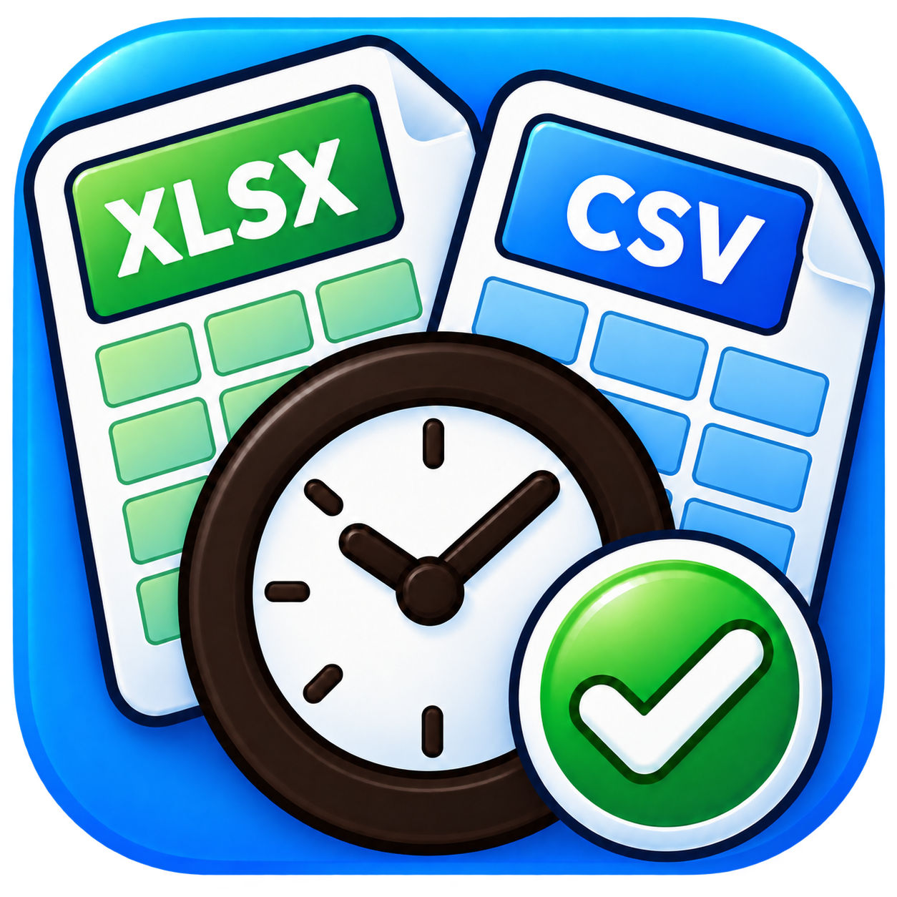

# AttendSync Trial48 — 採用アイコン更新

[最新版ZIPをダウンロード（約10.7MB）](https://github.com/alz7485/codex3/raw/refs/heads/main/downloads/AttendSync/AttendSync_Trial48_Approved_Icon_Complete.zip)

ユーザーが採用したアイコンをアプリへ反映しました。

- 元の青・緑のデザインを引き継ぎ、書類・時計・チェックの外形を明瞭にして大きく配置。
- 時計の枠・針・目盛りは黒に近い焦げ茶色。
- XLSX/CSV内の四角いセルは薄い枠線。
- アイコンの外側は透過。PNG・Windows ICO・Base64を一致させています。

Windows ICOは16/24/32/48/64/128/256pxの7サイズです。Qtで各サイズを読み込み、ライト・ダーク・最小サイズを含む主要メイン5画面を撮影しました。今回のUI静的確認とマニュアル10件は合格しています。本番Python・照合・設定・onedirビルドに変更はありません。

[Trial48の変更・検証](VALIDATION_TRIAL48.md)

メイン画面全体へのフォルダドロップ、枠線UI、JSONによる項目追加、画像付きマニュアルを維持しています。Trial47の全40テストと追加境界8件の監査を継承し、その記録もZIPに同梱しました。

[Trial47の監査](AUDIT_TRIAL47.md) / [Trial46専門レビュー](AUDIT_TRIAL46.md)

このZIPはソース版で、Windows EXEは含みません。Windowsで同梱の手順に従い build_onedir.py を実行してください。EXE内のアイコンは再ビルドで更新されます。会社へは生成した dist\AttendSync フォルダ全体（_internal・Manual等を含む）を渡してください。受取側にPythonは不要です。ExcelへのジャンプにはMicrosoft Excelが必要です。

Windows Explorerやタスクバーでの実表示、Windows EXEビルド、実Excel・プリンターは未確認です。更新前に既存userdataをバックアップしてください。

ZIP：382ファイル / 11,235,796バイト  
SHA256：`f1bc5682335f20ea4e09bc46f3776d4dc17cc229b2a5e010170ae4e04eac807f`
