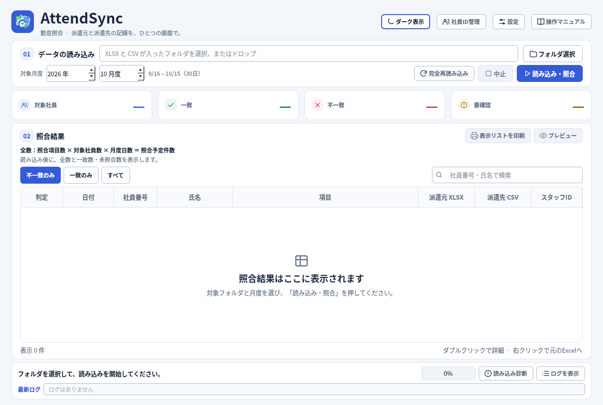

# AttendSync Trial44

[最新版ZIPをダウンロード（約10.3MB）](https://github.com/alz7485/codex3/raw/refs/heads/main/downloads/AttendSync/AttendSync_Trial44_Final_Audit_Complete.zip)

Trial43を監査し、社員ID管理の保存と絞り込みを修正しました。

- CSV未読込・氏名空欄・氏名末尾の空白がある場合も、表示名を混入させず実際のスタッフIDを保存します。
- 空白だけのIDを未紐づけとして表示し、前後の空白を除去して割当済み・重複IDを判定します。
- 新しく追加した社員も、候補選択・入力確定に合わせて未紐づけの絞り込みを更新します。
- 社員ID管理は未紐づけの社員を初期表示し、未紐づけが0人なら全員を表示します。
- 起動時のPCの日付の年・月を、そのまま対象月度に設定します。10月中の起動は10月度（9/16～10/15）です。1～15日も16日以降も同じ月度を選びます。起動後の手動変更は保持します。
- 月度日数・全数計算式・一致／不一致／判定要確認／未照合の表示、項目追加・ON/OFF・未知のJSON属性の保持を継承しています。

全数は「ON照合項目数 × 読み込み済みXLSX社員数 × 月度日数」です。欠落・重複・読み込み失敗などがある場合は全数一致とは表示しません。未読込社員の人数は全数に含められないため、読み込み診断も確認してください。

全35テストスクリプト成功。今回追加した社員ID監査8件も成功。120人の合成サンプルは一致10,797／不一致3／予定10,800項目を維持しています。[詳しい監査結果](AUDIT_TRIAL44.md)を参照してください。

Trial43以前でCSV未読込のまま社員ID管理から保存した場合は、staff_mapping.jsonのIDに表示用「—」が混入していないか確認してください。誤ったIDはCSVの元のスタッフIDで登録し直すかバックアップから復元してください。

画像付き操作マニュアル・設定・監査報告を同梱したソース版です。ZIP展開後、CODEX_START_HERE.txt と AttendSync/README.md を参照してください。Python環境と依存ライブラリが必要です。ビルド済みEXEは含みません。

Linuxでの起動描画は3回の中央値0.7624秒（旧Trial43は0.5870秒）でした。Windows実機・ビルド済みEXE・Excel COM実機・実プリンター・Trial44マニュアルの実ブラウザー確認は未実施です。

SHA256: `655b603ba6f9f2e43747be8edaab0afecf34417c6ea69b74967a77ce914ec6bc`
