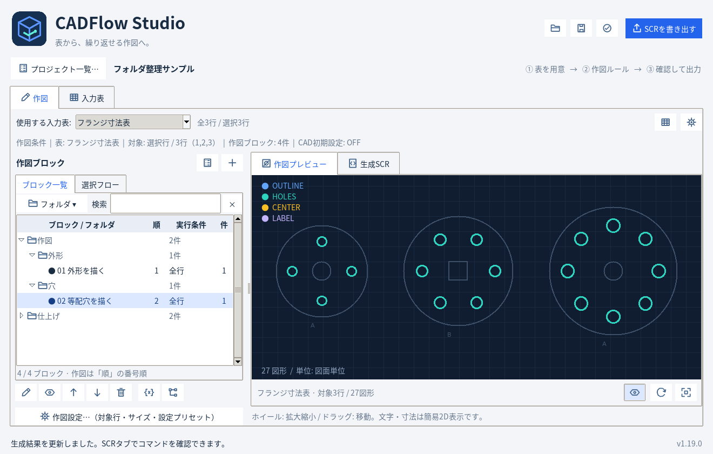

# CADFlow Studio 1.19.0

Excel / CSVの行と作図ブロックから、AutoCAD用のSCRを作成するWindows向けデスクトップアプリです。

**[最新版ZIPをダウンロード](https://github.com/alz7485/codex3/raw/refs/heads/main/downloads/CADFlowStudio/CADFlow_Studio_v1.19.0.zip)** / [SHA256](CADFlow_Studio_v1.19.0.zip.sha256)

公開日: 2026-10-24（JST）。**Pythonソース版**です。EXEは含みません。
WindowsでonedirのEXEを作成するコマンドと`CADFlowStudio.spec`をZIP内に同梱しています。



## ブロックをフォルダで管理

ブロック一覧へフォルダと子フォルダを追加しました。大量のブロックを「外形」「穴」「注記」「共通処理」などへ分類できます。

- フォルダの作成・名前変更・移動、複数ブロックのまとめ移動。
- 折りたたみ・全展開と、ブロック名・条件・フォルダ名による検索。
- フォルダ利用時は対象行・サイズの設定をボタンにまとめ、一覧を広く表示。
- 「順」列で実際の作図順を表示。フォルダ移動や検索では作図順・対象を変更しません。
- フォルダを削除してもブロックは未分類へ戻して保持します。
- 分類はプロジェクトJSONに保存し、Undo / Redoにも対応。

作図の構造は **プロジェクト → ブロック → コマンド** のままです。
「● 作図対象」は番号順に直接実行し、「◇ 呼び出し専用」はBLOCKコマンドから呼び出します。
フォルダのない旧JSONもそのまま開いて分類できます。保存モデル版11を維持しています。

[画像つきフォルダ操作ガイド](folder-guide-v1.19.0/)で操作と保存形式、`docs/BLOCKS.md`でブロックと旧形式の移行を説明しています。

## 引き続き利用できる機能

- 複数の入力表、セル編集、Tab移動、Excel範囲貼り付け。
- 選択行・行番号・全行での作図指定、サイズ設定と設定プリセット。
- プレビュー・生成SCR、選択と呼び出し先の強調、数式試算、検査から該当箇所への移動。
- 標準11タイプ、初期15件の登録コマンド、ユーザー登録とJSON共有。
- レイヤー・色・線種・線の太さ・印刷・文字/寸法スタイル・線種読込。
- 不足定義を作成する冒頭マクロのON/OFF、通常作図完了後のシステム設定復元。
- アイコンとツールチップ、省スペースのツールバー、右ペイン上端から使うプレビュー。
- JSONプロジェクト一覧、ウィンドウ・タブ・倍率復元、15秒ごとの未保存データ退避。

## 起動

ZIPをすべて展開し、`CADFlow_Studio_v1.19.0`フォルダーでPowerShellを開きます。
Python 3.11以降（標準のTkinterを含む）が必要です。

```powershell
py -3 -m pip install -r requirements.txt
py -3 src/main.py
```

`CADFlow Studio.pyw`のダブルクリックでも起動できます。
onedir形式のEXE化はZIP内の`EXE_BUILD_ONEDIR.md`を参照してください。

## 検証

基本処理175件・実際のTk GUI操作156件の**計331件合格、スキップなし**。
分類によるSCR・図形座標の不変、複数選択・検索・Undo・JSON再読込・再起動復元、300ブロックと1500段のフォルダ階層を検証しました。
詳細と環境・制限はZIP内の`docs/VALIDATION.md`に記録しています。
Windows EXEのビルド・実行とAutoCAD実機でのSCR実行は未検証です。

[前版1.18.0の画像つきブロック作成手順](block-guide-v1.18.0/)も参照できます。1.19のフォルダ操作はZIP内の新ガイドを確認してください。
