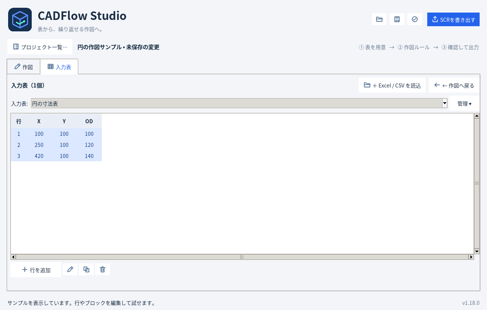
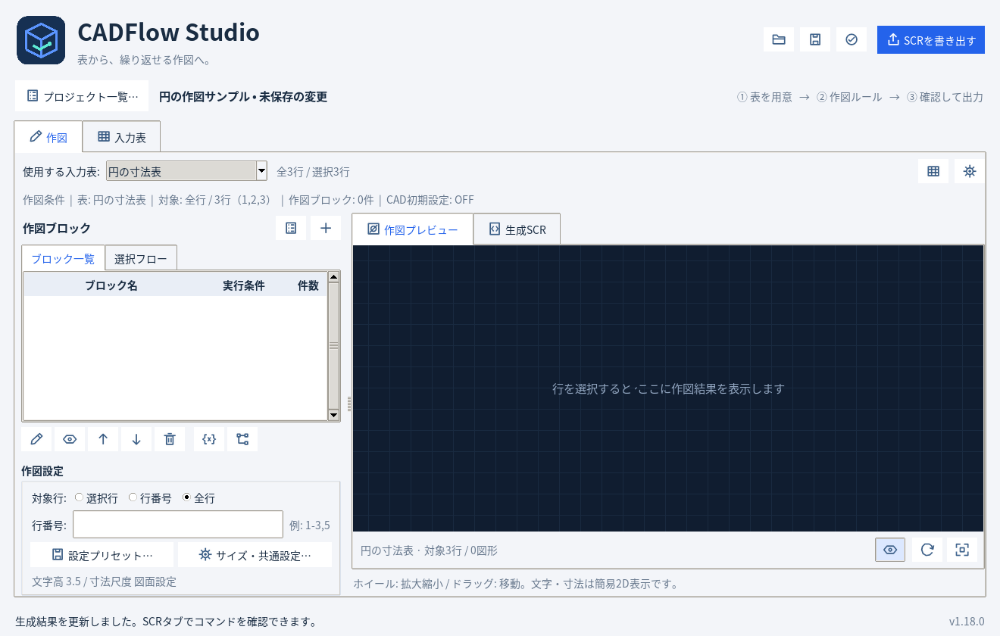
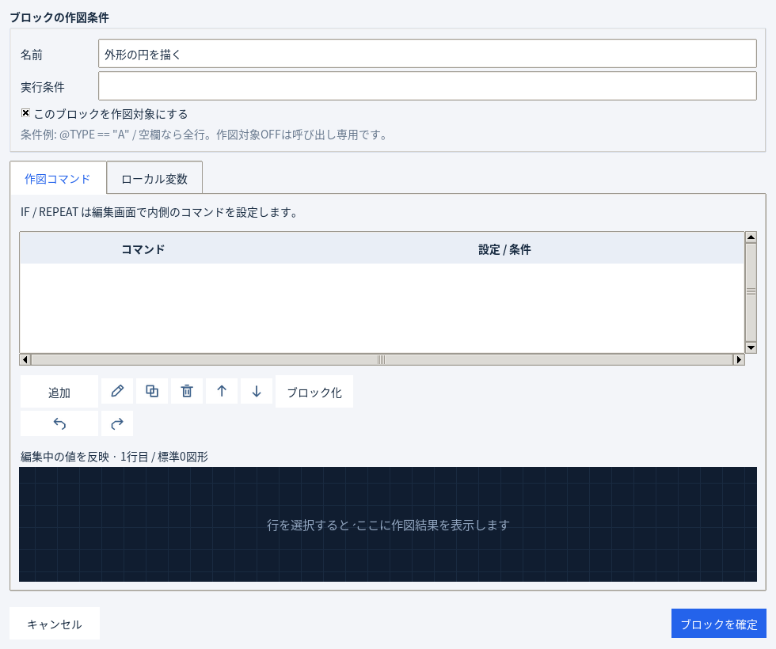
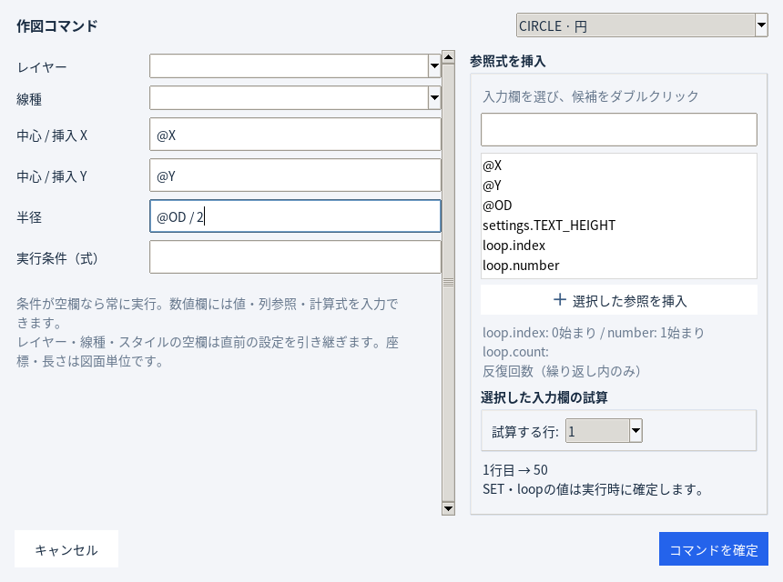
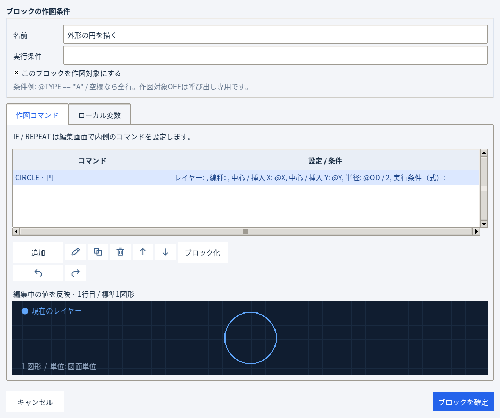

# ブロックの作成手順 — CADFlow Studio v1.18.0

ここでは、入力表の各行から円を1つずつ描くブロックを作成します。
画面はv1.18.0を実際に操作して撮影したものです。Windowsではフォントやウィンドウ枠の見た目が多少異なります。

作図の構造は **プロジェクト → ブロック → コマンド** です。ブロックにコマンドを直接追加します。
このアプリの「ブロック」は処理のまとまりを指します。

## 1. 入力表を用意する

「入力表」タブの「＋ Excel / CSV を読込」で表を読み込みます。
練習用の [circle-input.csv](circle-input.csv) を使うと、画像と同じ表を用意できます。

| X | Y | OD |
| ---: | ---: | ---: |
| 100 | 100 | 100 |
| 250 | 100 | 120 |
| 420 | 100 | 140 |

XとYが円の中心、ODが直径です。列名は半角英字で入力します。
サンプルプロジェクトを開いている場合は、新規プロジェクトから始めると既存の作図と重なりません。

## 2. ＋でブロックを追加する

「作図」タブに戻り、上部「使用する入力表」で表を選びます。
左の **「作図ブロック」右上にある＋アイコン** を押します。マウスを重ねると操作名が表示されます。

## 3. ブロックの名前と条件を設定する

開いた「ブロック編集」画面で次のように設定します。

| 項目 | この例の設定 |
| --- | --- |
| 名前 | 外形の円を描く |
| 実行条件 | 空欄 |
| このブロックを作図対象にする | ON |

実行条件が空欄なら、作図設定で指定したすべての対象行に対して実行します。
通常の作図は作図対象をONにします。「ローカル変数」は今回の例では設定不要です。

次に **「作図コマンド」タブの「追加」** を押します。

## 4. 円のコマンドを追加する

「コマンドの設定」右上の種類を **「CIRCLE · 円」** に変更し、次の値を入力します。

| 項目 | 入力する値 | 意味 |
| --- | --- | --- |
| 中心 / 挿入 X | `@X` | その行のX列 |
| 中心 / 挿入 Y | `@Y` | その行のY列 |
| 半径 | `@OD / 2` | 直径ODの半分 |
| 実行条件（式） | 空欄 | 常に実行 |
| レイヤー・線種 | 空欄 | CADの現在の設定、または直前のコマンドの設定を引き継ぐ |

値は直接入力できます。右側の参照候補をダブルクリックして入力欄へ挿入することもできます。
数値欄を選ぶと、右下の試算で実際の値を確認できます。例えば1行目の `@OD / 2` は50です。

固定サイズで描きたい場合は、半径欄へ `50` のように数値を直接入力します。

入力後、右下の **「コマンドを確定」** を押します。

## 5. ブロックを確定する

ブロック編集画面へ戻り、コマンド一覧に円が追加されたことを確認します。
下部には対象行のうち先頭1行分のプレビューが表示されます。

線・文字・寸法などを同じブロックへ追加したい場合は、再び「追加」を押します。
コマンドは一覧の上から順に実行します。↑↓で順番を変更できます。

最後に右下の **「ブロックを確定」** を押します。

## 6. 対象行と作図結果を確認し、保存する

メイン画面左下の「作図設定」で対象行を選びます。

| 選択肢 | 作図する行 |
| --- | --- |
| 選択行 | 入力表タブで選んだ行。Ctrl / Shiftで複数選択可能 |
| 行番号 | `1-3,5` のように指定した行 |
| 全行 | 使用する入力表の全行 |

この例では **「全行」** を選びます。表示が更新されない場合は **F5** で再生成します。
直径100・120・140の円が1つずつ表示されれば完了です。
「生成SCR」タブへ切り替えると出力内容も確認できます。

- **Ctrl+S**：プロジェクトをJSON保存します。入力表・ブロック・設定をまとめて保持します。
- **Ctrl+E** または右上 **「SCRを書き出す」**：CADで実行するSCRを出力します。

**「ブロックを確定」は編集中のプロジェクトへ反映する操作です。ファイルへ保存するにはCtrl+Sを押してください。**

完成した [circle-example.json](circle-example.json) をアプリで開くこともできます。

## 設定を入れる場所

| 設定したいこと | 操作する場所 |
| --- | --- |
| 作図する入力表 | 作図タブ上部「使用する入力表」 |
| 作図する行 | 左下「作図設定」の対象行 |
| 円の半径・線の端点など | 各コマンドの設定画面 |
| 文字高さ・寸法文字高・矢印サイズ・寸法尺度 | 左下「サイズ・共通設定…」 |
| 共通の図形サイズなど任意の値 | 「設定・変数」→「共通設定」。コマンドから `settings.名前` で参照 |
| ブロック内だけで使う計算値 | ブロック編集の「ローカル変数」タブ。`local.名前` で参照 |
| レイヤー・文字スタイル・寸法スタイル・線種読込 | 作図タブ右上の歯車「CAD初期設定…」 |

小さい画面では、対象行やサイズの設定は左下の **「作図設定…（対象行・サイズ・設定プリセット）」** にまとまります。

## 同じ処理を使い回す場合

通常の作図はここまでの手順で作れます。
同じ処理を別の場所から呼び出したい場合は、そのブロックの「このブロックを作図対象にする」をOFFにします。
別のブロックへ **「BLOCK · ブロック呼出」** コマンドを追加し、作ったブロックを名前で選びます。

OFFにしたブロックは「呼び出し専用」です。呼び出された場所で実行されます。
作図対象をONにしたまま呼び出すと、一覧からの直接実行と呼び出しの両方で実行するので、重複に注意してください。
