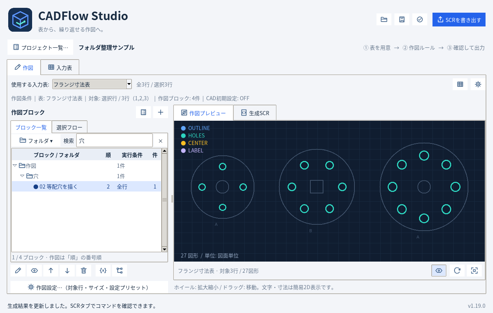

# ブロックをフォルダで整理する — CADFlow Studio 1.19.0

ブロックが増えたら、「外形」「穴」「注記」「共通処理」などのフォルダへ分けて管理できます。
フォルダには子フォルダを作成でき、使わない部分を折りたたみ、名前や条件で検索できます。

[フォルダ整理サンプルJSON](folder_organization.json) を開くと、「作図 → 外形 / 穴」と「仕上げ」へ分類したサンプルを試せます。
作図のコマンドと結果は、起動時のフランジサンプルと同じです。


## フォルダを作る

1. 「作図」タブのブロック一覧で、上部の「フォルダ ▾」を開きます。
2. 「フォルダを追加…」で名前を入力します。
3. 子フォルダを作る場合は、親にするフォルダを選択し、「子フォルダを追加…」を押します。

同じ親の中では、重複する名前を付けられません。違う親であれば同じ名前を使えます。
「フォルダの名前を変更…」「フォルダを移動…」も同じメニューから操作します。
右クリックでもメニューを開けます。フォルダ名はF2でも変更できます。

## ブロックを入れる

- 新しいブロックは、追加先のフォルダを選択して「＋ ブロック」で作成します。
- 既存のブロックは、選択して「選択ブロックを移動…」で移動先を選びます。
- Ctrl / Shiftで複数のブロックを選ぶと、まとめて移動できます。
- 分類を外す場合は、「選択ブロックを未分類へ」を使います。

ブロックやフォルダは、移動先のフォルダへドラッグして移動することもできます。

フォルダへ移動してもブロック名や呼び出し先は変わりません。
「● 作図対象」と「◇ 呼び出し専用」は、同じフォルダ内で管理できます。

## 折りたたみと検索

フォルダ左の三角を押すと、子フォルダとブロックをまとめて開閉します。
メニューの「すべて展開」「すべて折りたたむ」で一覧全体を開閉できます。

検索欄は、ブロック名・実行条件・所属フォルダの名前を対象にします。
例えば「穴」で検索すると、名前に「穴」を含むブロックや「穴」フォルダ内のブロックを探せます。
英字の大文字・小文字や全角・半角は区別しません。スペースで複数の語を入力すると、すべてを含むものを表示します。
検索中は該当箇所の親フォルダを自動で開きます。×または検索欄のEscで絞り込みを解除すると、検索前の開閉状態に戻ります。



## 作図順は「順」列で確認する

**実際の作図は「順」列の番号順です。** フォルダごとにまとめて表示している場合でも、番号が作図順を表します。
呼び出し専用のブロックは、従来どおりBLOCKコマンドから呼び出された場所で実行します。

フォルダへの移動・名前変更・検索・折りたたみは、作図する順番や対象を変更しません。
作図順を変更するときは、ブロックを選択して↑↓を使います。

フォルダは一覧を整理する分類です。「プロジェクト → ブロック → コマンド」という作図の構造はそのままです。

## 対象行・サイズの設定

フォルダを使うプロジェクトでは、一覧の表示領域を広く確保するため、対象行・サイズの設定を左下の **「作図設定…（対象行・サイズ・設定プリセット）」** にまとめています。
ボタンを開くと、対象行の選択やサイズ・共通設定、設定プリセットを変更できます。
フォルダのないプロジェクトは、通常のウィンドウサイズなら従来どおり一覧の下に設定欄を表示します。

## フォルダを削除する

フォルダを選択し、メニューの「フォルダを削除…」を実行します。
削除するフォルダと子フォルダの分類がなくなり、中のブロックはすべて「未分類」へ戻ります。
ブロック・コマンド・呼び出し・作図順は保持します。

分類を戻したい場合は、Ctrl+Zで操作を取り消せます。Ctrl+Yでやり直せます。
ブロック自体を削除する操作とは別です。

## 保存と旧プロジェクト

フォルダとブロックの所属先は、Ctrl+SでプロジェクトJSONへ保存します。
別のPCへJSONを移した場合も分類を引き継ぎます。
フォルダのない旧JSONは、そのままのブロック一覧として開きます。必要に応じて後から分類できます。

モデル版は11のままです。フォルダ分類は追加のメタデータとして保存し、作図コマンドのデータを二重に持ちません。

```json
{
  "version": 11,
  "block_folders": [
    {"id": "geometry", "name": "図形", "parent_id": ""},
    {"id": "holes", "name": "穴", "parent_id": "geometry"}
  ],
  "blocks": [
    {
      "id": "hole_circle",
      "name": "穴の円を描く",
      "folder_id": "holes",
      "draw": true,
      "condition": "",
      "variables": {},
      "commands": [
        {"type": "CIRCLE", "x": "@X", "y": "@Y", "r": "@OD / 2"}
      ]
    }
  ]
}
```

これはJSONの抜粋です。実際のプロジェクトには入力表や共通設定なども含みます。
親IDが空文字ならルート、ブロックの`folder_id`が省略または空文字なら未分類です。
名前変更はIDを維持し、所属先や呼び出しを壊しません。通常は画面から操作すればIDを入力する必要はありません。
